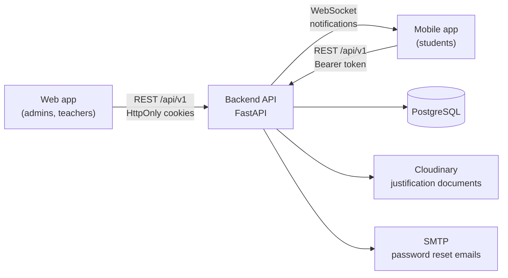
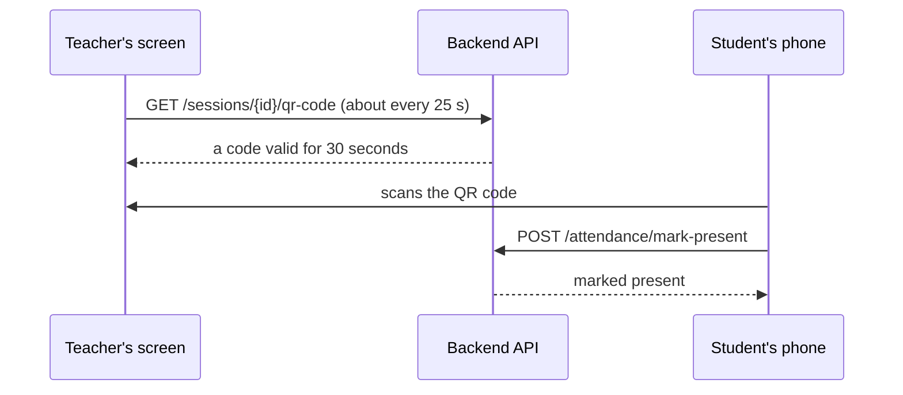

<h1 align="center">AMS: Absence Management System</h1>

<p align="center">
  Digital attendance for the Higher School of Computer Science of Sidi Bel Abbès (ESI-SBA):
  QR-code check-in, absence rules, justifications, make-up sessions and live notifications,
  for administrators, teachers and students.
</p>

<p align="center">
  
  
  
  
</p>

## Overview

This repository brings the three parts of the system together as Git submodules. Year-end project (PFA), 2025–2026, at ESI-SBA.

| Folder      | Repository                                                                               | Who uses it               | Built with                    |
| ----------- | ---------------------------------------------------------------------------------------- | ------------------------- | ----------------------------- |
| `backend/`  | [Absence-Management-backend](https://github.com/ay-boutera/Absence-Management-backend)   | the two apps below        | FastAPI, PostgreSQL, Alembic  |
| `frontend/` | [Absence-Management-frontend](https://github.com/ay-boutera/Absence-Management-frontend) | administrators, teachers  | Next.js, React, Tailwind CSS  |
| `mobile/`   | [Absence-Management-mobile](https://github.com/ay-boutera/Absence-Management-mobile)     | students                  | Flutter                       |

## How it fits together



### Checking in with a QR code



Because the code expires after 30 seconds, a photo of it sent to an absent friend is useless. The API and the student app implement this flow; in the web app, the QR window still shows a placeholder.

## What each role can do

| Role        | Main features                                                                                                                                         |
| ----------- | ----------------------------------------------------------------------------------------------------------------------------------------------------- |
| **Admin**   | Import students, teachers and the timetable (CSV); manage accounts and groups; review justifications, corrections and make-up requests; export CSV and PDF reports; set the absence rules |
| **Teacher** | See today's sessions; mark and correct absences (freely within 15 minutes after the session); follow their groups and each student's history         |
| **Student** | Check in with the QR code; follow absences per module and semester; justify an absence with a document; see the make-up sessions available; receive live notifications |

Absences are counted per module: a warning at 3 and exclusion at 5 by default (both set by the administration), and justified absences no longer count.

## Getting the code

```bash
git clone --recurse-submodules https://github.com/ay-boutera/Absence-Management.git
cd Absence-Management

# already cloned without the submodules?
git submodule update --init --recursive
```

Each part has its own setup guide: [backend](https://github.com/ay-boutera/Absence-Management-backend#getting-started), [web app](https://github.com/ay-boutera/Absence-Management-frontend#getting-started), [mobile app](https://github.com/ay-boutera/Absence-Management-mobile#getting-started). Start the backend first: both apps need it.

## Team

- [Boutera Ahmed Yassine](https://github.com/ay-boutera): backend
- [trarifouad](https://github.com/trarifouad): web app
- [i-brahmi](https://github.com/i-brahmi): mobile app
